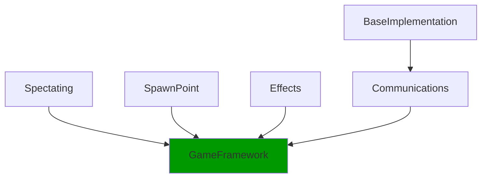

# Unity Game Framework Implementations
A collection of systems that implement unified game interface from [Game Framework](https://github.com/AwesomeProjectionGames/GameFramework) in Unity.

## Modules implemented
- **BaseImplementation**: Core implementations of Game Framework interfaces for Unity, including base classes for actors, controllers, components, and other fundamental systems
  - Others systems can be used standalone without this package, but not the opposite.
- **Spectating**: A spectate system implementation for GameFramework. Provides controllers and components for managing spectating functionality (UIs elements of a certain actor) and camera management.
- **Spawn Point**: An implementation of Spawn Points using the Game Framework interfaces.
- **Effects**: Provides controllers and components for managing objects effects (gameplay / attributes) tied to actors and gameplay events.
- **Communications**: A package that provides common communication mechanisms for Unity Game Framework-based projects, including event buses and tools to facilitate inter-system communication and interfaces workflow in Unity.

## State Serialization & Persistence
`AbstractActor` implements `ISerializedObject` for state snapshots (`Serialize()` / `Deserialize()`) using MemoryPack:
- **How it works**: Aggregates all sibling components implementing `ISerializedObject` into a `Dictionary<uint, byte[]>`.
- **Composite Key**: Uses a 32-bit key combining a 28-bit TypeHash (`comp.GetType().FullName`) and a 4-bit InstanceIndex (`0..15`, up to 16 components of the same type).
- **Ordering Limitation**: Multiple instances of the same component type are indexed by their hierarchy discovery order in `ComponentsContainer` (Unity depth-first traversal). Do not reorder child GameObjects of identical component types on an existing prefab across versions, as their index mapping could swap.

## Dependencies


* Packages in green like [Game Framework](https://github.com/AwesomeProjectionGames/GameFramework.git) are not part of this repository.

## Installation
To install these modules, you can use the Unity Package Manager. 
To do so, open the Unity Package Manager and click on the `+` button in the top left corner. 
Then select `Add package from git URL...`.

### Install prerequisites
Paste the following URLs one by one to install the required dependencies:
```
https://github.com/AwesomeProjectionGames/CoreUtils.git
https://github.com/AwesomeProjectionGames/GameFramework.git
```

### Option 1: Full Installation (All Modules)
Includes BaseImplementation, Spectating, SpawnPoint, Effects, and Communications.

```
https://github.com/AwesomeProjectionGames/UnityGameFrameworkImplementations.git
```

Or you can manually add the following line to your `manifest.json` file located in your project's `Packages` directory.

```json
{
  "dependencies": {
    "com.awesomeprojection.gameframework.base": "https://github.com/AwesomeProjectionGames/UnityGameFrameworkImplementations.git",
  }
}
```

### Option 2: Modular Installation
Install only specific modules. You can do this for all folders except `BaseImplementation` as it is using the rest of the modules as dependencies.

```
https://github.com/AwesomeProjectionGames/UnityGameFrameworkImplementations.git?path=/Communications
https://github.com/AwesomeProjectionGames/UnityGameFrameworkImplementations.git?path=/Inventory
https://github.com/AwesomeProjectionGames/UnityGameFrameworkImplementations.git?path=/Optimisation
https://github.com/AwesomeProjectionGames/UnityGameFrameworkImplementations.git?path=/Reactive
https://github.com/AwesomeProjectionGames/UnityGameFrameworkImplementations.git?path=/SpawnPoint
https://github.com/AwesomeProjectionGames/UnityGameFrameworkImplementations.git?path=/Spectating
https://github.com/AwesomeProjectionGames/UnityGameFrameworkImplementations.git?path=/SurfaceMetadata
```